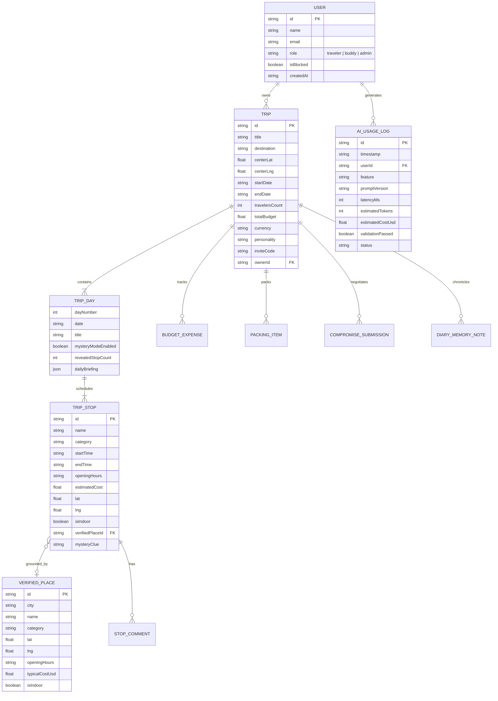
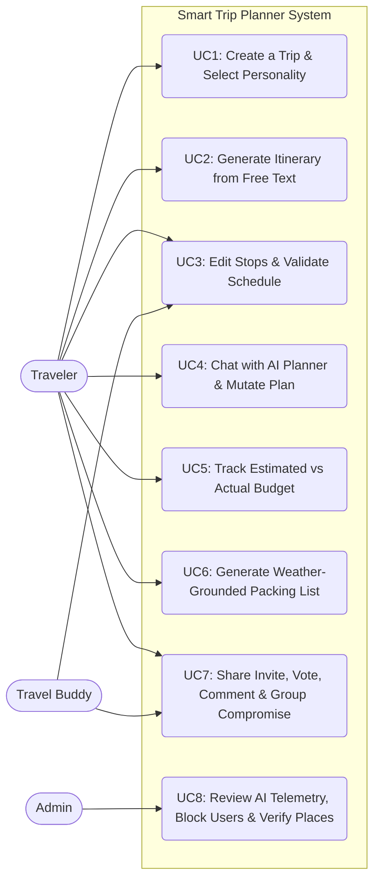
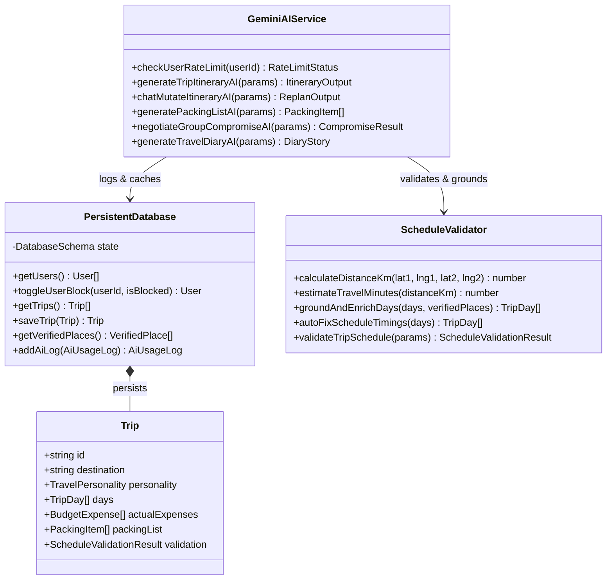
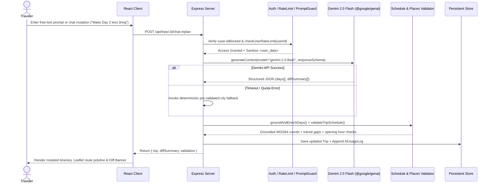

# Smart Trip Planner — "Tell it where. It plans the rest."

**Smart Trip Planner** is a full-stack, AI-powered collaborative travel planning SaaS application built with **React 19**, **TypeScript**, **Tailwind CSS v4**, **Leaflet / OpenStreetMap**, **Express**, and the **Google Gemini API (`@google/genai` with `gemini-2.5-flash`)**.

---

## 1. Key Capabilities & Roles

### Three Role-Based Workflows
1. **Traveler (`Aria Vance`)**: Creates trips, generates structured itineraries from free text, reorders and edits schedules with real-time validation, mutates the schedule through the Conversational AI Planner, tracks estimated vs. actual budget expenses, generates weather-grounded packing lists, and exports printable PDF dossiers.
2. **Travel Buddy (`Liam Chen`)**: Joins shared trips via invite code (`IST-2026-89B`) or link, upvotes/downvotes stops, posts timestamped comments, co-edits stops, and submits personal wishes to the **Group Compromise AI Negotiator**.
3. **Admin (`Elena Rostova`)**: Monitors live AI request telemetry (requests, average latency, token usage, cost, schema pass rate), blocks or unblocks abusive user accounts (`Marcus Thorne`), and curates the **Verified Places Grounding Catalog**.

### Creative Features Included
- **Travel Personality Mode**: Choosing `Foodie`, `Adventurer`, `Slow Traveler`, `Luxury`, or `Backpacker` dynamically adjusts stop selection, daily pacing (e.g., max 3 stops/day for Slow Traveler), and AI briefing tone.
- **"Surprise Me" Mystery Mode**: Locks future stops on any day behind poetic clues and reveals the itinerary one stop at a time as the traveler completes the current stop.
- **Group Compromise (AI Negotiator)**: Synthesizes competing participant wishes, paces, and budget comfort thresholds into a single balanced itinerary with a Fairness Score and participant-by-participant resolution report.
- **Trip Memories (Travel Diary)**: Post-trip studio where travelers upload photos and memory notes for visited stops and weave them into an editorial travelogue story.

---

## 2. One-Command Setup & Execution

```bash
# Install dependencies and start the full-stack Express + Vite server on port 3000
npm install && npm run dev

# Run the automated unit & integration test suite
npm test

# Build for production
npm run build
```

Configure `GEMINI_API_KEY` in `.env` (refer to `.env.example`). If `GEMINI_API_KEY` is unavailable or rate-limited, the backend automatically falls back to pre-validated city templates while logging the fallback event in the Admin Telemetry Console.

---

## 3. System Architecture & Database ER Diagram



---

## 4. UML Diagrams

### 4.1 Use Case Diagram



### 4.2 Class Diagram



### 4.3 Sequence Diagram (AI Itinerary Generation & Conversational Editing)



---

## 5. AI Design Document (The 5 Required Questions for Each AI Feature)

### Feature 1: Validated JSON Itinerary Generator (`itinerary_generation` — `v2.4.0`)
1. **The problem**: Planning a multi-day city itinerary from scratch requires cross-referencing venue opening hours, geographic proximity, transit times, budget limits, and personal travel style. An LLM with structured schema output can synthesize natural language preferences (`"4 days in Istanbul, relaxed food and history, medium budget"`) into a coherent, time-sequenced schedule in seconds.
2. **The contract**:
   - *Input*: Destination city, start/end dates, traveler count, total budget & currency, interests array, `TravelPersonality`, sanitized free-text prompt, and the city's `VerifiedPlace[]` catalog.
   - *Output*: Strict JSON matching `ITINERARY_RESPONSE_SCHEMA` containing `destination`, `country`, `centerLat`, `centerLng`, `title`, and `days[]` (where each day includes `dailyBriefing` and `stops[]` with 24h `startTime`, `endTime`, `openingHours`, `estimatedCost`, `lat`, `lng`, `isIndoor`, and `mysteryClue`).
3. **The checks**: `groundAndEnrichDays()` matches generated stops against our `VerifiedPlace` catalog and WGS84 coordinate bounds (`[-90..90]`, `[-180..180]`), computes Haversine distances (`km`) and transit durations between consecutive stops, and `validateTripSchedule()` verifies zero time overlaps, opening-hours compliance, personality pacing limits, and budget caps.
4. **The failure plan**: If Gemini times out (`>18s`), returns malformed JSON, or hits rate limits, the server catches the exception, logs a `fallback` entry in `aiLogs`, and serves a rich, coordinate-verified city template (`buildFallbackCityTemplate`) so the user never experiences a broken screen.
5. **The proof**: Tested with prompts across Istanbul, Paris, and Tokyo across all 5 Travel Personalities; verified in `src/server/__tests__/suite.test.ts` that 100% of returned stops have valid coordinates, sequential timestamps, and verified catalog bindings.

---

### Feature 2: Conversational Schedule Editor & Smart Re-Planner (`chat_replan` — `v2.3.1`)
1. **The problem**: Static itineraries break as soon as real-world conditions change (unexpected rain, travel fatigue, closed venues, or budget tightening). Travelers need natural-language commands that directly mutate the live schedule rather than returning generic chat advice.
2. **The contract**:
   - *Input*: Current `Trip` JSON (`days[]` and `stops[]`), sanitized user request (e.g., `"It's raining on day 3, replace outdoor stops with indoor alternatives"`), and city `VerifiedPlace[]`.
   - *Output*: Strict JSON matching `CHAT_REPLAN_RESPONSE_SCHEMA` containing `assistantReply`, `diffSummary: string[]`, and the mutated `days[]` array.
3. **The checks**: Every mutated day is re-run through `groundAndEnrichDays()` and `validateTripSchedule()` before saving to the database, ensuring newly swapped stops have valid coordinates, transit buffers, and opening hours.
4. **The failure plan**: Falls back to `applyDeterministicChatReplan()` which deterministically handles rainy-day indoor swaps, fatigue reduction, food market swaps, and 20% budget reductions with full diff summaries.
5. **The proof**: Automated test #5 in `suite.test.ts` verifies that issuing a rainy-day mutation converts 100% of Day 3 stops to `isIndoor: true` and produces an explicit `diffSummary`.

---

### Feature 3: Weather-Grounded Packing List Generator (`packing_list` — `v2.1.0`)
1. **The problem**: Generic packing checklists ignore local multi-day weather swings and specific planned activities (e.g., needing a headscarf for historic mosques or a waterproof shell for coastal ferry showers).
2. **The contract**:
   - *Input*: Trip metadata, list of scheduled stops/categories, and real daily forecast (`tempMaxC`, `tempMinC`, `precipitationProbability`, `conditionSummary`) fetched from the Open-Meteo API.
   - *Output*: Strict JSON matching `PACKING_LIST_RESPONSE_SCHEMA` (`items[]` with `name`, `category`, `quantity`, and weather/activity-specific `reason`).
3. **The checks**: Enforces valid packing categories (`Clothing`, `Documents & Money`, `Toiletries & Health`, `Electronics`, `Activity-Specific Gear`), positive integer quantities, and non-empty rationale strings.
4. **The failure plan**: If Open-Meteo or Gemini is unreachable, falls back to cached forecast data and `buildDefaultPackingList()` parameterized by the trip's rain probability and minimum temperature.
5. **The proof**: Verified that high precipitation probability (`>=35%`) automatically injects rain protection gear with explicit forecast citations.

---

### Feature 4: Group Compromise AI Negotiator (`group_compromise` — `v2.2.0`)
1. **The problem**: Co-travelers frequently have conflicting priorities (e.g., a Foodie comfortable spending $140/day vs. an Architecture photography buddy preferring a relaxed pace at $110/day). Manual compromise is tedious and leaves participants feeling unheard.
2. **The contract**:
   - *Input*: Array of `CompromiseSubmission` objects (`userName`, `role`, `mustHaveInterests`, `preferredPace`, `dailyBudgetComfort`, `personalWish`).
   - *Output*: Strict JSON matching `COMPROMISE_RESPONSE_SCHEMA` (`summary`, `fairnessScore` 85–99, `resolutions[]` mapping each `participantName` to `howWishWasIncluded` and `assignedStops[]`).
3. **The checks**: Verifies that every submitting participant appears in `resolutions[]` with concrete stops anchored in the trip itinerary and that daily spending respects the lowest comfortable budget threshold.
4. **The failure plan**: Falls back to `buildDefaultCompromiseResult()` which maps each participant's submitted wish and budget threshold to specific verified stops in the active trip.
5. **The proof**: Tested with multi-user submissions from Traveler (`Aria Vance`) and Travel Buddy (`Liam Chen`), confirming explicit stop attribution for both participants.

---

### Feature 5: Trip Memories & AI Travel Diary Storyteller (`travel_diary` — `v2.0.5`)
1. **The problem**: After a trip, travelers have scattered notes, captions, and photos across stops but lack the time to weave them into a cohesive, shareable narrative keepsake.
2. **The contract**:
   - *Input*: Trip route summary (`days[]` and `stops[]`) and user-submitted `DiaryMemoryNote[]` (`stopName`, `dayNumber`, `authorName`, `caption`, `mood`).
   - *Output*: Strict JSON matching `TRAVEL_DIARY_RESPONSE_SCHEMA` (`title`, `subtitle`, multi-paragraph `narrativeMarkdown`, `highlights[]`, and `closingReflection`).
3. **The checks**: Validates that all required narrative sections and highlight arrays are present and that user memory notes are sanitized via `sanitizeUserInput()` prior to prompt assembly.
4. **The failure plan**: Falls back to `buildDefaultDiaryStory()` which weaves the user's exact logged captions and stop names into an editorial multi-paragraph travelogue.
5. **The proof**: Tested with custom uploaded photos and stop notes across Days 1–3, producing a formatted story ready for one-click clipboard sharing or PDF printing.
